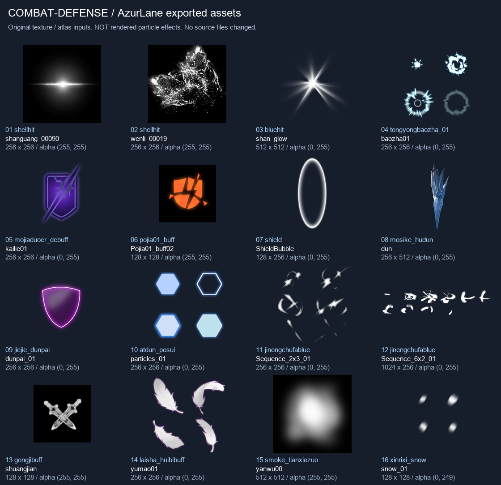
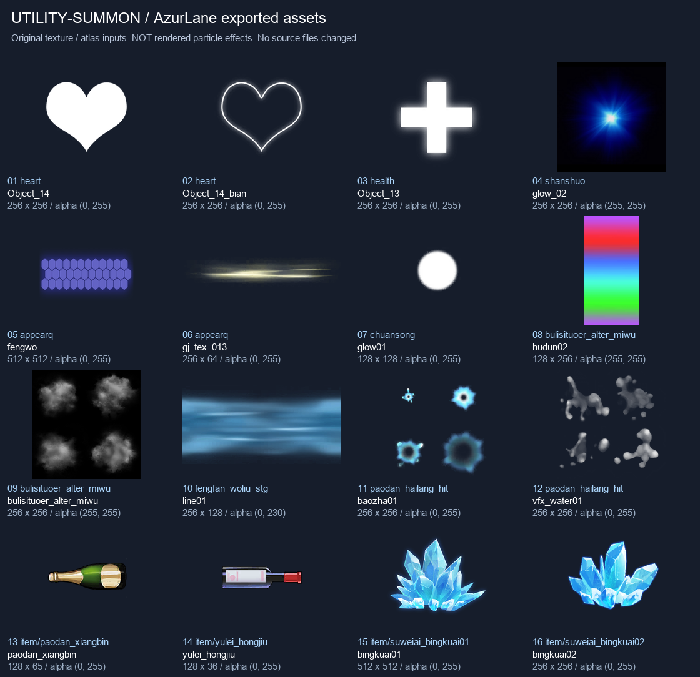

# AzurLane 全量解包：塔什干卡牌演出素材调研

调研日期：2026-11-03。资源根目录 `D:/GitClone/AzurLane/data`。本轮仅调研并整理索引图，没有修改现有运行代码、卡牌效果或运行素材，也没有重新解包全库。

## 结论与优先级

现在最值得补的是「命中端」「装填成功」「护盾建立／破碎」「消耗与转化」，不是再给已完成的炮口、雷达、鱼雷飞行和移动尾迹叠更多层。

建议下一批依次做：

1. 炮弹命中替换泛用斩击：装填射击、炮火打击、抵近射击等。
2. 卡牌实际装填成功的白色光弧，建立与炮口开火不同的视觉反馈。
3. 格挡建立与破碎、破浪尖刀的格挡转化。
4. 核心击穿、谍报制胜的短暂断能／破除标识。
5. 凛冬之志与伏特加转化、战场幽魂、召唤入场等特色牌专属表现。

下表中的时长和粒子预算均为建议，不是已经实现或测过的性能结论。

## 这批数据实际提供了什么

- 解包项目的 `reports/summary.json` 与 `reports/audit.json` 报告：73,654 个输入均有处理记录，422,002 个输出，约 76.74 GiB；3,705 套 Spine 转到 4.2.43；3,486 个输入失败，51,282 个为部分成功。这些是既有解包项目的报告，本轮没有重做其全量审计。
- 本轮复核 41 组特效候选，逐文件检查 114 张不同路径的依赖贴图，尺寸全部与二进制元数据一致；其中 7 组新增候选还读取了保留原包的粒子／材质／shader 引用。7 组的非空材质引用均已解析。
- 制作 32 个原始贴图样本的两张索引图，并检查四套现有角色、偶像版、箭头和塞壬鱼雷共 7 套 Spine 的版本、动作名与时间轴。
- 很多 `data/effect/<效果>` 文件夹只有 `ParticleSystemEvent.json`。真正贴图在 `data/artresource/...` 的依赖目录。导出的 PNG／材质 JSON／FBX 不等于可以直接导入 Godot 的 Unity 粒子 prefab。
- 索引图展示的是原始纹理／图集输入，不是粒子成品动画。黑底纹理需要对应的加法混合；法线、mask、UV 渐变不能直接当 sprite 贴上去。

## 按卡牌映射的建议

资源 ID 相对于 `D:/GitClone/AzurLane/data`；完整候选、依赖路径和元数据另见调研工作目录。

| 优先级 | 对应卡牌／机制 | 可用素材 | 具体演出与触发边界 | 适配成本 |
| --- | --- | --- | --- | --- |
| A | 装填射击、炮火打击、抵近射击、炮雷合击：炮弹命中 | `effect/shellhit`、`effect/shellhitsmall`、`effect/bluehit` 的依赖 | 敌人实际命中点短白闪、少量碎屑和烟；一发约 0.15～0.3 秒。按实际攻击段播放，不按弹药显示数预播；可替换当前泛用 slash，保留已有炮口表现 | 低～中，2～3 层 sprite |
| A | 集束炸弹、致命一击：强单击 | `effect/tongyongbaozha_01/baozha01.png`、`artresource/effect/shiyue/al_smoke12/AL_Smoke12.png` | 敌人位置一次较强冲击环，外带几粒碎屑。集束炸弹当前是一段单体伤害，不应演成连续伤害或全体爆炸；多簇画面可同一命中时刻完成 | 低～中；优先精简版，不照搬 `tongyongbaozha02` 的 14 套粒子 |
| A | 等待时机、设备升级、装填射击抽到时、其他实际装填成功 | `artresource/effect/jinengchufa/sequence_2x3_01/Sequence_2x3_01.png`、`.../sequence_6x2_01/Sequence_6x2_01.png` | 围绕被装填的卡牌弹药图标转过一小段白色弧光，0.2～0.35 秒。以旧／新弹药实际增加为准；已满装填不假装补入弹药。卡牌在手牌／处理区可见时才挂局部效果，位于文字后方 | 低，2×3 或 6×2 序列，不是 4×4 |
| A | 防御、物资整备、强化钢材、同舰共济：获得格挡 | `artresource/effect/shield/shieldbubble/ShieldBubble.png`、`artresource/effect/jiejie/dunpai_01/dunpai_01.png` | 角色身前小范围展开一层薄盾／短弧，0.2～0.4 秒后减弱。强化钢材获得覆甲时可多一层少量六边形。多人同舰共济只在真正获得格挡的队友身前播放 | 低～中；不要让每层格挡叠一套常驻盾 |
| A | 破浪尖刀：格挡转化为增伤 | `artresource/effect/atdun/materials/particles_01/particles_01.png`、`effect/gongjibuff/shuangjian.png` | 旧护盾在角色身前碎成几块，碎片向增伤提示收拢，约 0.35 秒。只在实际失去格挡并获得对应增伤时增强；这张是 Skill，不应凭名字做挥刀攻击 | 低；前者是四块六边形纹理，宜裁成独立片，不误当完整动画 |
| A | 核心击穿：本回合临时削力量 | `effect/mojiaduoer_debuff/kailie01.png` | 命中后闪出短暂的紫色裂盾／断能标识，约 0.25 秒；弱化显示可随临时能力移除消失。实际是临时削力量，不是永久破甲，不增加破格挡数值 | 低；原图与 alpha 可直接用，不必照搬原循环 |
| A | 谍报制胜：移除人工制品并施加缓慢／失衡 | `effect/pojia01_buff/Pojia01_buff02.png` | 目标确实存在并失去 Artifact 时，橙色碎盾标识弹开；缓慢／失衡可用一圈短的紫白干扰光。原本没有 Artifact 就不播放「破除护盾」反馈 | 低；单张破盾标识＋现有光点 |
| B | 斩鲸、踏浪猎杀、驱退：水流命中 | `effect/paodan_hailang_hit/baozha01.png`、`dorm3d/effect/texture/vfx_water01/vfx_water01.png` | 保留已有角色位移短浪，另在敌人受击处做局部白浪／扁平冲击，不重铺整条场地。驱退按敌人实际后退方向分配喷溅；群体效果建议同屏预算 6～8 个轻命中 | 中，取 1～2 层，不照搬 7 套原粒子 |
| B | 进水专家、海王形态的鱼雷触发 | 上述水滴图集，或 `effect/yulei_bolang_hit` 依赖 | 进水专家真实施加虚弱／负力量时，在命中敌人下半部补一次水滴；海王触发可短促增强既有浪潮。仍保留目前 TheBomb 原版爆炸核心 | 中；不改鱼雷结算顺序、不假造进水持续掉血 |
| B | 战场幽魂：消耗手牌／有条件获得无实体 | `effect/bulisituoer_alter_miwu/bulisituoer_alter_miwu.png` | 使用这张 2×2 灰烟图集，消耗时卡牌附近轻散烟；只有 `exhaustedCount == 0` 的无实体分支成功时才加角色短雾化。可在无实体存在时保留极弱一层，不遮人物和卡牌 | 中；舍弃原 prefab 的 UV 彩条、扭曲和常驻环 |
| B | 凛冬之志：增抽、手牌转伏特加 | `item/suweiai_bingkuai01/bingkuai01.png`、`item/suweiai_bingkuai02/bingkuai02.png`、`xinrixi_snow` 依赖 | 自身脚边小冰晶／寒气闪过，转化发生时凝出一张伏特加牌。用少量白色飘粒作点缀；不会在敌人身上套冰块，不暗示冻结／眩晕 | 低～中；两张苏维埃冰晶本身可直接裁片复用 |
| B | 伏特加、何以解忧、烈酒盛宴 | `item/paodan_xiangbin/paodan_xiangbin.png`、`item/yulei_hongjiu/yulei_hongjiu.png`、`gongjibuff` 的增伤光点 | 借用小酒瓶轮廓做卡牌上方短摆动、上升气泡和暖色增伤闪光；伏特加实际是获得 Vigor 并抽牌，不是治疗。香槟／红酒原图造型需去掉鱼雷／酒种识别细节再用，不能称为现成伏特加图 | 中，有主题美术调整，不建议直接整瓶当鱼雷发射 |
| B | 模块血量／ModuleOrb | `shield` 小薄盾，`artresource/effect/health/object_13/Object_13.png` | 生成模块时在球槽附近出现简短装甲闭合；模块实际降低承伤时轻闪。激发模块确实会治疗，此时才用小十字／恢复光点 | 低～中；区分 Channel、限伤和 Evoke，不给出牌本身假治疗 |
| B | 救援减费；预备选项的选择提示 | `shanshuo` 的 `glow_02`、`artresource/effect/jiantou/jiantou_skeletondata` | 救援：在真正被设为本回合免费的卡牌费用图标旁闪一下，或箭头指向新费用；预备：只点亮选中的突进／后撤选项，执行位移时沿用已有水花。不要把救援误做治疗，也不把预备说成减费牌 | 低；箭头可以裁单张，没必要为小提示常驻整套 Spine |
| B | 来去如风：召唤入场 | `effect/appearq`／`effect/appearsmall` 依赖、`effect/chuansong/glow01.png` | 现有两个召唤物出现的位置各一次小光圈／泡沫散开，约 0.3 秒；只在召唤真的发生时播放。保留当前召唤物外观，不擅自替换为其他舰娘 | 低～中；原 `appearq` 有 8 套粒子，取轻量层 |
| C | 永恒誓言 | `effect/heart/Object_14.png`、`Object_14_bian.png` | 打出时小心形轮廓和柔光，不表现治疗；战斗胜利后追加誓约奖励时再有一次轻提示，不挡住奖励按钮、不等待动画完成 | 低，但频率要克制 |
| C | 婉若游龙／翩若惊鸿的身法点缀 | `artresource/effect/laishajineng/materials/yumao01/yumao01.png` | 2×2 白羽纹理可以只落 2～3 片，作罕见身法牌点缀。两张牌实际有位移／回收／攻击等不同逻辑，不表示获得闪避。塔什干主题更偏水，羽毛不如已做短浪统一，优先级较低 | 低，但风格风险高于技术成本 |

## 索引图与具体样本

图片仅把原贴图合成到深底便于观察；没有把它们改画为新的游戏素材。图中编号可用于挑选下一批实现。

- 图一 01～04：普通／重击命中输入。
- 图一 05～06：紫色裂盾与橙色碎盾；分别适合临时断能与实际破除 Artifact。
- 图一 07～10：薄盾、冰片盾、紫盾、六边形碎片。08 的莫斯科盾实际是一块细长冰片，不应仅按名字当成完整防护罩；09 原色偏粉紫，若不改色需确认和塔什干色系相容。
- 图一 11～12：两套可做装填反馈的光弧序列。
- 图一 14～16：白羽、软烟、短白飘粒；`snow_01` 并不是标准六角雪花。

- 图二 01～03：心形和恢复十字。只对实际效果使用，不按卡名误判为治疗。
- 图二 08 是 UV 彩条／shader 输入，不能直接显示成光圈；09 才是可用的 2×2 烟纹理。
- 图二 11～12：水冲击与水滴四帧输入；不能把整张图集当一个水花显示。
- 图二 13～14：小酒瓶轮廓可改造，但原本是香槟／红酒／弹药外观，不是纯伏特加素材。
- 图二 15～16：两张可直接复用的苏维埃冰晶贴图。

## Spine：新目录有哪些值得关注

### 当前四套人物

`data/char/tashigan`、`tashigan_2`、`tashigan_3`、`tashigan_4` 都有完整 4.2.43 骨骼、atlas 和图页，且同样具有 20 个动作。已有项目已接入这些皮肤，不建议仅因重新转换过就覆盖项目正在使用的骨骼。

| 动作 | 已核对时长 | 可以考虑的用途 | 限制 |
| --- | --- | --- | --- |
| `dance` | 原皮 2 秒，2／3／4 皮约 1.17／0.83／1.33 秒 | 烈酒盛宴、活力迸发、能力成功发动时短庆祝 | 各皮肤动作不同；完成自动回 normal，不等待，也不要打断下一张攻击 |
| `skill` | 四皮均约 6 秒 | 罕见大能力的表现候选 | 名字不代表已适合所有技能；原动作较长，必须先逐皮动态预览。当前 Cast 映射 attack_left 已可用，不直接全替换 |
| `yun` | 四皮均约 2 秒 | 只有确实需要醉态／失衡趣味表现时作可选项 | 不因用了伏特加就默认表现为眩晕、失能；不优先 |
| `stand`／`stand2` | 约 8.33～13.67 秒，皮肤不一致 | 角色展示、罕见 cut-in／场外互动 | 不宜用于每张牌；不应等待全长才继续 |
| `move`／`move_left`、`victory` | 已有 | 保留当前位移、胜利接入 | 不重新重复订阅或二次播放 |

动作名和时长已经核对，但本轮没有对每个动作逐皮逐帧播放，不能据名称保证视觉姿态适合某张牌。

### 偶像版

`data/char/tashigan_idol` 现在有完整的 4.2.43 `.skel`、JSON、atlas 和图页。相比四套当前皮肤多 `idol`（约 3.23 秒）与 `jump`（约 1.67 秒），可作为以后第五套皮肤／可选演出素材来源。换用它会改变角色外观，不应在某张普通卡结算时无提示切成偶像版；暂不建议直接加入本批战斗特效。

### 轻量外部 Spine

- `data/artresource/effect/jiantou/jiantou_skeletondata`：4.2.43，3 骨骼、2 插槽，`move` 约 1.33 秒，适合借用箭头做卡牌费用／选择提示。完整 Spine 可用性仍需在 Godot 正式导入；仅做提示可裁图更省。
- `data/artresource/item/bulletall/sairenyulei/sairenyulei_skeletondata`：4.2.43，1 骨骼、1 插槽，`bullet` 约 0.2 秒，主要是两张图切换。它是塞壬鱼雷外观，不比当前高清塔什干鱼雷更合适；若以后做特殊皮肤，可借其两帧闪动方式，不建议直接替换现有鱼雷。
- `data/spinepainting/tashigan_4_res`：4.2.43，244 骨骼、122 插槽，动作 `1`～`8` 与 `normal`。属于另一量级的立绘骨骼，可考虑罕见演出面板，但不适合给日常连发同时挂多套；本轮只检查结构，未判定数字动作内容。
- `data/item/tashigan_elf` 目前目录只有脚本 JSON，没有本地同目录图页／完整骨骼，不能仅按名称认定它是一个已可直接接入的塔什干随从。

## 暂时不建议照搬的内容

1. 大型原生特效：`junengshexian` 有 20 个粒子组件，`bulunnusi_hudun` 有 14 个，原包还有扭曲、mask 和网格 shader。只抽一两层，不能直接作为每次攻击的常驻 prefab。
2. 蓝色整场漩涡：`fengfan_woliu_stg` 有长寿命循环、扭曲和网格。其 `line01` 可借作局部水流，但现有脚下短浪已经足够，不值得重复铺全屏。
3. 原包循环：`pojia01_buff`、迷雾和部分 buff 原配置为循环；多数建议只做 0.2～0.5 秒一次性演出，真正持续状态由现有 power 生命周期管理。
4. 雪花／冰锥攻击：塔什干相关卡不因此获得冻结；「凛冬」「模块血量」「救援」「进水」都应先看实际代码，不能按名称添加错误状态暗示。
5. 覆盖原有反馈：鱼雷继续保留 TheBomb 命中核心、现有 12／24 上限、非阻塞胜利与炮口连发节奏。新素材若替换这些已确认需求，应单独讨论，不顺手取消。

## 下一轮实现约束

- 只使用已经同步确定的目标、攻击段、实际格挡／装填／转化结果；外观随机不能消耗玩法 RNG。
- 闪光、余波、短姿态都不增加 Cmd.Wait 或等待 Spine finish；战斗结束、死亡、卡牌回池时统一清理。
- 一次群体命中不生成无限全尺寸爆炸，同类持续效果不按层数叠节点。
- 卡牌局部表现必须在描述文字后面，不挡费用／弹药数量和选择输入；战场波浪不压住手牌。
- 在现有静态模型、四套皮肤、向左／向右、正式／Beta、多人高速模式验证后再确定性能预算。本轮未进行这些新增演出的局内或双机联机测试。

## 调研记录

工作目录：`D:/GitClone/.codex-build/tashkent-azurlane-survey-20261103`。

- `candidates.json`：41 组候选的粒子、shader、纹理来源和当前导出路径。
- `texture-checks.json`：114 张不同路径贴图的实际／声明尺寸核对；无不一致。
- `visual-index.json`：两张索引图的 32 个样本及原始路径、尺寸、alpha 范围。
- `spine-checked.json`：7 套轻量／角色 Spine 的已核对动作时长和事件。
- 七份新增原包元数据：`*.raw.json`。未修改解包源文件。
